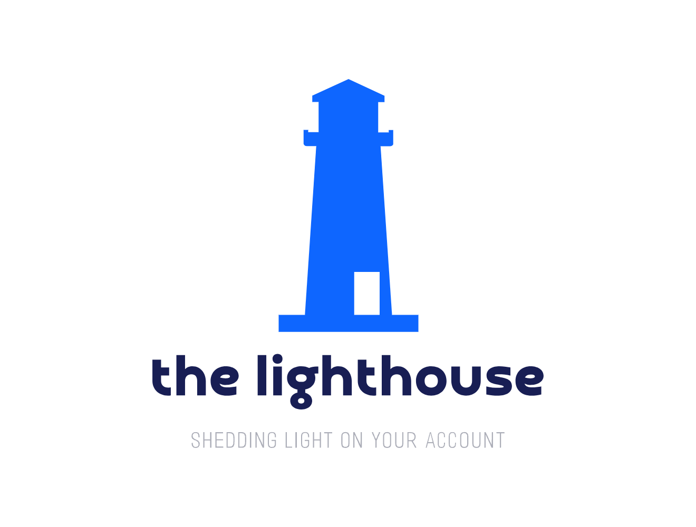

<div align="center">
  
  <h1>The Lighthouse</h1>
  <p>
    <strong>Multi-Tenant Billing, Security Auditing &amp; Customer Self-Service Portal</strong>
  </p>
</div>

---

A full-stack, multi-tenant billing and account-monitoring portal built with the MERN stack. It provides internet service providers and subscription-based organizations with a dynamically branded customer self-service portal alongside dedicated internal dashboards for frontline support agents and tenant managers.

The application shifts investigative and self-service power directly to subscribers—allowing them to visualize prorated first bills, generate temporary Support PINs, monitor login history, and upgrade service tiers in one click—while keeping billing agents in the loop via tenant-isolated, real-time Socket.io alerts.

## 🌟 Features

* **Multi-Tenant Architecture & RBAC:** Strict organization-scoped data isolation via indexed `orgId` references across all collections, with three distinct roles (`Manager`, `Agent`, and `Subscriber`) enforced on both the frontend (`RoleRoute`) and backend (`requireRole`).
* **Dynamic Tenant White-Labeling:** Subscriber and staff portals dynamically inject custom `portalName` titles and `themeColors` into Vanilla CSS custom properties (`--primary-brand-color`, `--secondary-brand-color`) upon session hydration.
* **3-Step Organization Onboarding Wizard:** Guides new tenants through organization branding, payment gateway configuration, and initial Service Catalog setup, gating subscriber creation until onboarding is complete.
* **Real-Time Agent Alerts (Socket.io):** JWT-authenticated, tenant-isolated WebSocket rooms push instant plan-upgrade and billing notifications to frontline Agent Dashboards without requiring a page refresh.
* **Security-First Auth & Auditing:** Uses HTTP-only, `SameSite=Strict` JWT cookies (zero `localStorage` tokens), `bcryptjs` hashing for passwords and Support PINs, and automated `LoginHistory` auditing (IP address, User-Agent, and timestamp).
* **Signature Self-Service Tools:**
  * **First Bill Proration Visualizer:** Interactive CSS Grid/Flexbox timeline explaining overlapping activation and billing cycle days.
  * **Secure 6-Digit Support PINs:** Cryptographically generated, hashed temporary PINs with a live 10-minute expiration countdown.
  * **One-Click Speed Tier Upgrades:** Server-validated tier jumps (`newPlan.speedTier > currentPlan.speedTier`) wired directly to live agent notifications.
  * **Real-Time Network Outage Banners:** Conditional top-of-viewport status alerts powered by per-tenant `NetworkStatus` records.

## 🛠️ Tech Stack

* **Frontend:** React (Vite), React Router (`react-router-dom`), Vanilla CSS (CSS Variables), `socket.io-client`, Native `fetch()` API (`credentials: 'include'`)
* **Backend:** Node.js (ES Modules), Express.js, Socket.io, `cookie-parser`, `cors`
* **Database:** MongoDB, Mongoose
* **Authentication & Security:** JSON Web Tokens (`jsonwebtoken` via HTTP-Only Cookies), `bcryptjs`

## 🚀 Getting Started

Follow these steps to set up and run The Lighthouse locally.

### Prerequisites

* **Node.js** (v20+ LTS recommended) & npm
* **MongoDB** (MongoDB Atlas cluster URI or local Dockerized MongoDB)
* **Git**
* *(Windows Developers)* **WSL2 (Ubuntu)** is recommended—keep the repository inside the native Linux filesystem (e.g., `~/projects/the-lighthouse`) for fast Git, npm, and Vite HMR performance.

### Installation

1. **Clone the repository**
   ```bash
   git clone git@github.com:zacharybaca/the-lighthouse.git
   cd the-lighthouse
   ```

2. **Install Backend Dependencies**
   ```bash
   cd server
   npm install
   ```

3. **Install Frontend Dependencies**
   ```bash
   cd ../client
   npm install
   ```

4. **Configure Environment Variables**

   Create a `.env` file inside `server/` (private backend secrets — never commit to Git):
   ```env
   PORT=5000
   NODE_ENV=development
   MONGO_URI=mongodb+srv://<username>:<password>@<cluster-url>/TheLighthouse
   JWT_SECRET=replace_with_a_strong_32_plus_char_random_string
   JWT_EXPIRES_IN=24h
   CLIENT_URL=http://localhost:5173
   STRIPE_SECRET_KEY=sk_test_your_backend_secret_key
   ```

   Create a `.env` file inside `client/` (public Vite variables only — never place backend secrets here):
   ```env
   VITE_API_URL=http://localhost:5000/api
   VITE_SOCKET_URL=http://localhost:5000
   VITE_STRIPE_PUBLIC_KEY=pk_test_your_frontend_public_key
   ```

5. **Seed the Database**
   Populate MongoDB with linked test records (Organization, Plans, Staff, Subscribers, Invoices, Notifications, and LoginHistory):
   ```bash
   cd ../server
   npm run seed
   ```
   *(Alternatively, run `node utilities/seed.js` from inside `server/`.)*

## 🏃‍♂️ Running the Application

Open two terminal windows to run the backend and frontend concurrently:

**Terminal 1 (Backend — Express + Socket.io on `http://localhost:5000`):**
```bash
cd server
npm run dev
```

**Terminal 2 (Frontend — Vite React App on `http://localhost:5173`):**
```bash
cd client
npm run dev
```

## 🧪 Seeded Test Accounts

All seeded accounts share the password **`Password123!`**:

| Role | Email | Password | What to Test |
| :--- | :--- | :--- | :--- |
| **Manager** | `manager@beaconfiber.example` | `Password123!` | ManagerDashboard, live branding editor, Service Catalog CRUD, Staff provisioning, `LoginHistory` audits |
| **Agent** | `agent@beaconfiber.example` | `Password123!` | AgentDashboard, live Socket.io upgrade banners, subscriber lookup, Support PIN verification, refunds |
| **Subscriber (Tier 1)** | `maya.lin@example.com` | `Password123!` | SubscriberDashboard, First Bill Proration Visualizer, 6-digit Support PIN, Tier 1 → Tier 2 upgrade |
| **Subscriber (Tier 2)** | `devon.brooks@example.com` | `Password123!` | Failed invoice alert badge testing, Tier 2 → Tier 3 upgrade |

> **Real-Time Smoke Test:** Open two browser windows side by side (one regular, one incognito). Sign in as the **Agent** in Window 1 and as **Maya Lin (Subscriber)** in Window 2. Trigger a one-click speed tier upgrade from Maya's dashboard and confirm the live alert banner appears on the Agent Dashboard without refreshing the page.

## 🌳 Project Tree Directory

```text
the-lighthouse/
├── .gitignore
├── README.md
├── client/
│   ├── .env                                 # Local Vite config (gitignored)
│   ├── eslint.config.js
│   ├── index.html
│   ├── package.json
│   ├── package-lock.json
│   ├── vite.config.js
│   ├── public/
│   │   ├── favicon.svg
│   │   └── icons.svg
│   └── src/
│       ├── App.css
│       ├── App.jsx
│       ├── index.css
│       ├── main.jsx
│       ├── assets/
│       │   └── the-lighthouse-logo.png
│       ├── components/
│       │   ├── AccountAtAGlance/
│       │   │   ├── AccountAtAGlance.jsx
│       │   │   └── account-at-a-glance.css
│       │   ├── AgentDashboard/
│       │   │   ├── AgentDashboard.jsx
│       │   │   └── agent-dashboard.css
│       │   ├── Auth/
│       │   │   └── Login.jsx
│       │   ├── HomePage/
│       │   │   ├── HomePage.jsx
│       │   │   └── home-page.css
│       │   ├── ManagerDashboard/
│       │   │   ├── ManagerDashboard.jsx
│       │   │   └── manager-dashboard.css
│       │   ├── OnboardingWizard/
│       │   │   ├── OnboardingWizard.jsx
│       │   │   └── onboarding-wizard.css
│       │   ├── Routing/
│       │   │   └── RoleRoute.jsx
│       │   ├── SubscriberDashboard/
│       │   │   ├── SubscriberDashboard.jsx
│       │   │   └── subscriber-dashboard.css
│       │   └── TransactionMonitor/
│       │       ├── TransactionMonitor.jsx
│       │       └── transaction-monitor.css
│       ├── context/
│       │   └── AuthContext.jsx
│       ├── hooks/
│       │   └── useSocket.js
│       ├── layouts/
│       │   └── DashboardLayout.jsx
│       ├── services/
│       │   └── api.js
│       └── styles/
│           └── variables.css
└── server/
    ├── .env                                 # Private backend secrets (gitignored)
    ├── package.json
    ├── package-lock.json
    ├── server.js
    ├── config/
    │   └── db.js
    ├── controllers/
    │   ├── authController.js
    │   ├── invoiceController.js
    │   ├── notificationController.js
    │   ├── orgController.js
    │   ├── planController.js
    │   ├── staffController.js
    │   ├── subscriberController.js
    │   └── subscriptionController.js
    ├── middleware/
    │   └── authMiddleware.js
    ├── models/
    │   ├── Invoice.js
    │   ├── LoginHistory.js
    │   ├── NetworkStatus.js
    │   ├── Notification.js
    │   ├── Organization.js
    │   ├── Plan.js
    │   ├── Staff.js
    │   └── Subscriber.js
    ├── routes/
    │   ├── authRoutes.js
    │   ├── invoiceRoutes.js
    │   ├── notificationRoutes.js
    │   ├── orgRoutes.js
    │   ├── planRoutes.js
    │   ├── staffRoutes.js
    │   ├── subscriberRoutes.js
    │   └── subscriptionRoutes.js
    └── utilities/
        └── seed.js
```